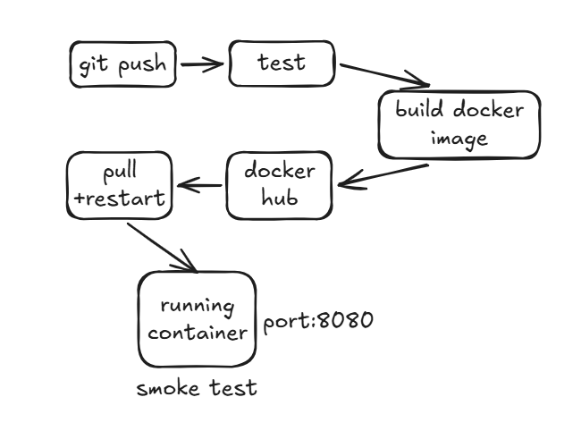
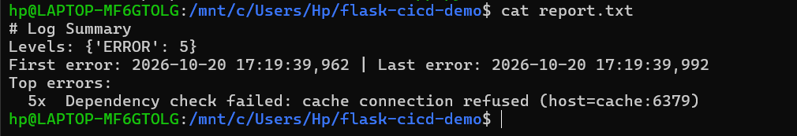
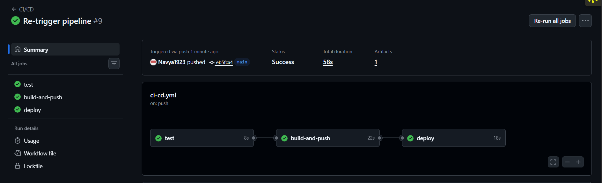
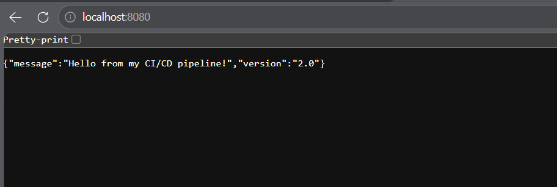
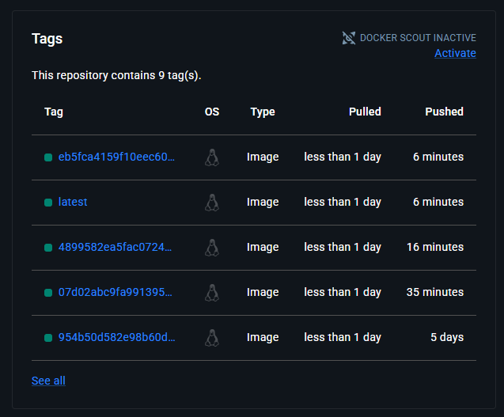

# Flask CI/CD Pipeline with Self-Hosted Runner


A containerized Flask service with a fully automated delivery pipeline. Every push to `main` is **tested, built into a Docker image, published to Docker Hub, and deployed by a self-hosted GitHub Actions runner**, followed by an automatic smoke test.

The project also includes a **failure-injection mode**, a **log-analysis script**, and a documented **incident RCA**, to practice the full cycle of deploy, detect, diagnose, roll back, and document.



## Why I built this

I work in production support on containerised telecom core systems, where troubleshooting, health checks, and root cause analysis are daily tasks. I built this project to understand the other side of that world: how containerised software gets built, tested, shipped, and recovered when something goes wrong.

The Flask app is deliberately simple. The pipeline around it is the real project.

## Tech stack

| Area | Tools |
|---|---|
| Application | Python 3.12, Flask, Gunicorn |
| Testing | pytest |
| Containers | Docker, Docker Hub |
| CI/CD | GitHub Actions (hosted runners for test and build, self-hosted runner for deploy) |
| Environment | Ubuntu on WSL2 with Docker Desktop |
| Scripting | Python (log analyzer), Bash |

## How the pipeline works

The workflow is in [`.github/workflows/ci-cd.yml`](.github/workflows/ci-cd.yml) and has three jobs.

1. **test:** runs `pytest` on every push and pull request.
2. **build-and-push:** runs only on pushes to `main`, and only if tests passed. Builds the image and pushes it to Docker Hub with two tags: `latest`, and the commit SHA (an immutable tag that makes rollback possible).
3. **deploy:** runs on a self-hosted runner. Pulls the new image, replaces the running container, prunes old images, and runs a smoke test against `/health`. If the app does not respond, the job fails.

Tests gate the build, and the build gates the deploy, so broken code never reaches the running app.

## API endpoints

| Endpoint | Purpose | Response |
|---|---|---|
| `/` | Returns a message and the app version | `200` |
| `/health` | Liveness: is the process alive? | `200` |
| `/ready` | Readiness: can the app serve traffic? | `200`, or `503` when `FAIL_MODE=true` |

Setting `FAIL_MODE=true` makes `/ready` log an ERROR and return `503`, which simulates a bad configuration so incidents can be practiced safely.

## Run it locally

```bash
git clone https://github.com/Navya1923/flask-cicd-demo.git
cd flask-cicd-demo

python -m venv venv
source venv/bin/activate        # Windows: venv\Scripts\activate
pip install -r requirements.txt -r requirements-dev.txt
pytest

docker build -t flask-cicd-demo .
docker run -d -p 5000:5000 --name demo flask-cicd-demo
curl localhost:5000/health
```

Failure mode:

```bash
docker rm -f demo
docker run -d -p 5000:5000 -e FAIL_MODE=true --name demo flask-cicd-demo
curl -i localhost:5000/ready     # returns 503
docker logs demo                 # shows the ERROR line
```

Image on Docker Hub: https://hub.docker.com/r/ghildiyal2003/flask-cicd-demo

## Set it up yourself

1. Create a Docker Hub access token (Read & Write).
2. Add repository secrets `DOCKERHUB_USERNAME` and `DOCKERHUB_TOKEN` under Settings, Secrets and variables, Actions.
3. Set up a self-hosted runner on a Linux machine with Docker (Settings, Actions, Runners, New self-hosted runner).
4. Make sure the Docker Hub repository is public.
5. Push to `main` and watch the Actions tab.

## Incident drill and RCA

I simulated a bad deployment and worked through the whole cycle:

| Step | What I did |
|---|---|
| Break | Deployed a known-good image with `FAIL_MODE=true` |
| Detect | Called `/ready` repeatedly and saw `503` responses |
| Diagnose | Ran `analyze_logs.py` on the container logs to find the error window and top error |
| Roll back | Redeployed the previous image using its commit-SHA tag |
| Verify | Confirmed `/ready` returned `200` again |
| Document | Wrote the incident up in an RCA |

Usage:

```bash
docker logs app 2>&1 | python3 analyze_logs.py
```

Output from the drill:

```
# Log Summary
Levels: {'ERROR': 5}
First error: 2026-10-20 17:19:39,962 | Last error: 2026-10-20 17:19:39,992
Top errors:
  5x  Dependency check failed: cache connection refused (host=cache:6379)
```



Full write-up: [RCA-001](docs/rca-001.md)

The incident is fully simulated. No real production logs, systems, or data are used in this repository.

## Screenshots

**Successful pipeline run**




**App running after automated deploy**



**Image tags on Docker Hub**




## Project structure

```
flask-cicd-demo/
├── .github/workflows/ci-cd.yml   # CI/CD pipeline
├── docs/
│   ├── images/                   # Screenshots and diagrams
│   └── rca-001.md                # Incident write-up
├── app.py                        # Flask application
├── test_app.py                   # pytest tests
├── analyze_logs.py               # Log analysis script
├── Dockerfile
├── requirements.txt
├── requirements-dev.txt
└── README.md
```

## Security notes

- Credentials are stored as encrypted GitHub secrets, never in the code.
- Docker Hub uses an access token, not an account password.
- `.gitignore` excludes `.env` and `*.pem` files.
- A self-hosted runner executes workflow code on my own machine, so outside-collaborator workflows require approval and deploy runs only on pushes to `main`.
- This is a personal learning setup. For production I would use ephemeral, isolated runners.

## What I learned

- Dockerfile layer order and build caching
- Liveness vs readiness checks
- Immutable SHA tags for fast, exact rollback
- Gated pipelines and post-deploy smoke tests
- Incident workflow: detect, diagnose from logs, roll back, document an RCA
- Debugging real problems: YAML indentation, Docker and WSL integration, runner setup, Git token authentication

## Future improvements

- [ ] Terraform for infrastructure
- [ ] Deploy to a cloud VM or Kubernetes with Helm
- [ ] Prometheus and Grafana monitoring with alerts
- [ ] HTTPS with a reverse proxy
- [ ] Container vulnerability scanning in the pipeline
- [ ] Automatic rollback when the smoke test fails

## Author

**Navya Ghildiyal** · [GitHub](https://github.com/Navya1923) 